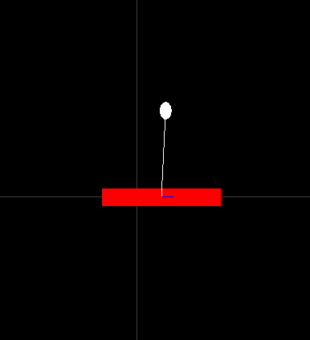
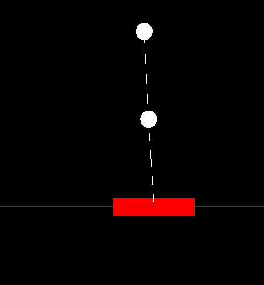
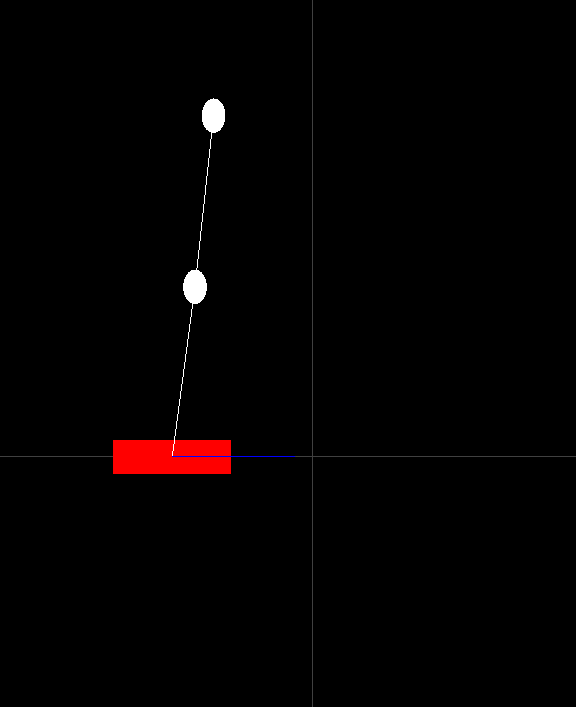

# Pendulum Controller

Pendulum Controller is a C++20 simulation and control project for cart-pole
systems. It includes a real-time SFML visualizer, several classical
controllers, a double-pendulum model, and a Python extension for experimenting
with reinforcement-learning policies.

The project currently focuses on:

- Simulating a single or double inverted pendulum.
- Swinging a pendulum up and stabilizing it with feedback control.
- Comparing manual, energy-based, PID, full-state, LQR, and neural controllers.
- Exporting a trained single-pendulum policy to a self-contained C++ controller.

## Screenshots

### Single pendulum



### Double pendulum




## Requirements

- A C++20 compiler.
- CMake 3.28 or newer.
- Git, so CMake can download SFML and pybind11 with `FetchContent`.
- Python and the Python development headers if the `pendulum_pysim` module is
  built or the Python scripts are used.
- A graphical environment for the SFML application.

SFML 3.1.0 and pybind11 2.13.6 are downloaded automatically during CMake
configuration. On Debian or Ubuntu, the SFML build may also require the
development packages listed in the [SFML Linux dependencies
documentation](https://github.com/SFML/SFML/blob/3.1.x/README.md#installing-sfml).

## Build and run

From the repository root:

```sh
cmake -S . -B build -DCMAKE_BUILD_TYPE=Release
cmake --build build
./build/bin/main
```

The executable opens the real-time simulation window. The default build runs a
single pendulum with the full controller: an energy controller swings the
pendulum up, then an LQR controller stabilizes it.

### Controls

| Input | Action |
| --- | --- |
| Left arrow | Apply force to the left |
| Right arrow | Apply force to the right |
| `Q` / `D` | Move the camera left / right |
| `Z` / `S` | Move the camera up / down |
| Mouse wheel | Zoom in or out |
| Space | Reset the pendulum and camera |

Manual input takes priority whenever an arrow key is held. The applied force
is limited to the range `[-10, 10]`.

## Choosing the simulation

The visualizer is configured in [`src/main.cpp`](src/main.cpp). Set the
`DOUBLE` compile-time flag to `true` to use the double-pendulum simulation and
its double-controller implementations:

```cpp
#define DOUBLE true
```

Rebuild after changing the flag:

```sh
cmake --build build
./build/bin/main
```

The single-pendulum default parameters are a cart mass of `1`, pendulum mass
of `0.5`, and pendulum length of `1`. The double-pendulum parameters are
configured in the same file.

## Controllers

Controller interfaces and implementations are in
[`include/control/`](include/control/):

- **Manual**: direct left/right keyboard input.
- **Zero**: applies no force.
- **PID**: proportional-integral-derivative feedback.
- **Energy**: swings the pendulum toward the upright position.
- **LQR**: stabilizes the linearized system near upright.
- **Full**: switches between energy-based swing-up and LQR stabilization.
- **Neural**: loads a serialized multilayer perceptron policy.

The simulation models are implemented in
[`include/simulation/`](include/simulation/) and
[`src/simulation/`](src/simulation/).

## Python simulation module

CMake also builds the `pendulum_pysim` Python extension. It exposes the
single-pendulum simulator with methods for updating the state, applying force,
setting state, and reading state:

```python
import sys
sys.path.insert(0, "build")

import pendulum_pysim

pendulum = pendulum_pysim.Pendulum(1.0, 0.5, 1.0)
pendulum.set_state(0.0, 0.0, 3.14159, 0.0)
pendulum.add_force(0.0)
pendulum.update(1.0 / 60.0)
print(pendulum.get_state())
```

The extension is generated from
[`src/bindings/pendulum_bindings.cpp`](src/bindings/pendulum_bindings.cpp).
Python utilities for deriving LQR gains and double-pendulum equations are in
[`scripts/`](scripts/).

## Neural-controller models

The repository includes serialized policies in [`models/`](models/). The
single-pendulum neural controller expects a JSON policy with the network
weights and biases used by the `PendulumMLP` implementation.

To try a neural policy, update the controller selection in
[`src/main.cpp`](src/main.cpp) and provide the model path relative to the
project root. For example, `models/stabilize.json` is included in the
repository.

## Project layout

```text
include/       Public C++ headers for simulation, control, rendering, and math
src/           C++ implementations, application entry point, and Python bindings
scripts/       Python tools for LQR calculations and symbolic dynamics
models/        Exported neural-network policies
images/        Screenshots used by this README
documentation/ Supporting technical documentation
extern/        Vendored third-party headers
```

## License

Pendulum Controller is released under the dual-license terms in
[`LICENSE.md`](LICENSE.md): Public Domain or MIT, at your option.
